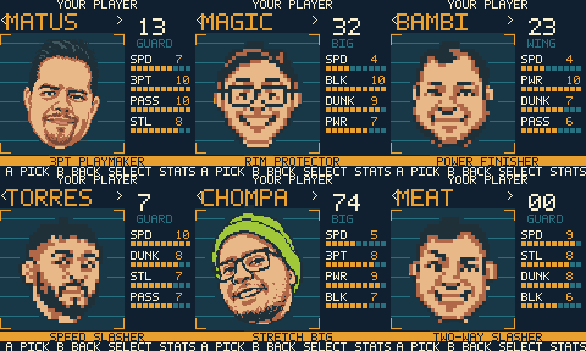
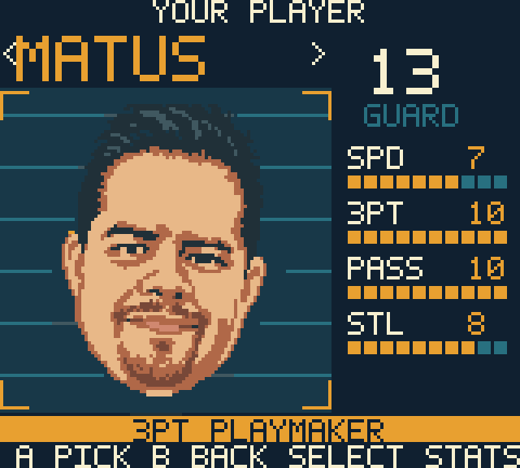

# Unified player cards — 2026-11-03

All six selection cards now use the large portrait composition with a full-width
gold specialty ribbon. MATUS's `3PT PLAYMAKER` no longer sits in the narrow stat
column. The approved playstyle text and numeric ratings are unchanged. The
footer reads `A PICK   B BACK`. Since 2026-11-05 a teal `SELECT / ALL STATS` key
under the four featured stats shows how to reach the full ratings (the old footer
hint `SELECT STATS` was easy to miss). Select still cycles both full rating pages
and B closes a rating page before navigating back.

MATUS and CHOMPA retain exactly the same 96×96 packed portrait pixels at
coordinates (3, 28), verified against the previous committed cards. The four
compact portrait masters enlarge 3× with integer cells; no portrait source was
edited. Home artwork, intro frames, IDs and native project metadata are unchanged.

`scripts/create-front-proof.py` generates all 24 selection-stage cards and their
palette routing. `jam_front_card` selects the card for each roster ID/stage;
the existing scouting-card generator still supplies the full rating pages.

## Verification

- Official Node 24 CLI ROM build passes. GBC-only 4 MiB cartridge SHA-256:
  `cddb227bf9a7c707bc03dc24dcc2399596a2baf24057e03731888101d6937c09`.
- Genuine PyBoy 2.7.0 frames: all six cards, both rating pages for every player,
  return to cards, roster wrap, teammate/opponent headers, difficulty, period
  selection, lineup review and match entry pass. Every card matches all 23,040
  packed source pixels after the emulator's RGB555 expansion.
- [Exact inputs, frame numbers and hashes](card-layout-evidence.json) are
  retained with the PNGs. Plugin recording quota was full; no old recordings
  were deleted or archived. These are direct emulator-step receipts/captures,
  not a replayable plugin recording.
- `sh scripts/test.sh` passes with sanitizers and warnings as errors.
- Official source export and sprite budget check pass at 190/192 reserved
  sprite tiles. The card backgrounds use at most 234/256 tiles across two VRAM
  banks, within the existing front-art allocation. No new WRAM buffers.
- Official browser export passes and MATUS's new card was visually checked in
  the built-in browser. Browser-export ROM SHA-256:
  `398b0698e4477e415d7b7f5859e1210fc07057fdc7080e161989b934e7c2119d`.
  The browser is left open on his card. Physical hardware was not tested.

## Actual cartridge captures

[Attack ratings](card-layout/ratings-1.png),
[defense ratings](card-layout/ratings-2.png),
[teammate](card-layout/lineup-0.png),
[first opponent](card-layout/lineup-1.png),
[second opponent](card-layout/lineup-2.png),
[lineup review](card-layout/lineup-5.png), and
[match entry](card-layout/lineup-6.png).
