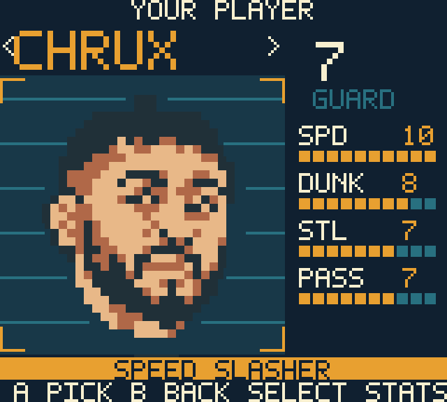

# CHRUX rename — 2026-11-03

The roster's fourth player is now CHRUX throughout the editable project,
README/design notes, generation scripts, asset paths, native resource names,
cards, full-rating pages, lineup/results text and Dunk Cam lettering. Existing
ratings, jersey `7`, playstyle and portrait cells are unchanged. The named player
palette key and all its references were migrated together; UUID resource IDs
remain unchanged. Intro background pixels were preserved byte-for-byte.

Historical capture filenames and documentation references use the new spelling.
Their pixels remain genuine evidence of their original builds; they have not
been retouched to change the name shown in those older games.

## Validation

- Official CLI ROM build passes: GBC-only 4 MiB, SHA-256
  `3614e7edaebd33aad37ad94a4e64b476878681d1321f54312d4c83ee0b48ee8c`.
- Direct PyBoy 2.7.0 input checks show CHRUX on the player card, both full-rating
  pages, return to the card and lineup review; the selected lineup starts a
  match successfully. [Inputs and frame hashes](chrux-rename/evidence.json).
- All existing sanitizer rules tests pass. Source export and sprite-budget
  check pass at 190/192 tiles. Generated Dunk Cam frames stay at 123/128 tiles
  maximum, and the newly generated CHRUX lettering was visually inspected.
- Portrait JSON comparisons confirm unchanged source cells/palettes for CHRUX,
  MATUS and CHOMPA; all roster ratings, jerseys and playstyles are unchanged.
- Case-insensitive search finds no previous spelling in working source text or
  non-ignored paths. The built ROM contains CHRUX and no previous uppercase
  spelling. Git history, ignored build archives and historical image pixels are
  retained.
- Official web export compiles successfully, SHA-256
  `747e09ac675de63672ae6920eba9128370dd9b3f6241f64a31916298175ca153`.
  Preview replacement reports `Browser recording close acknowledgement is
  UNKNOWN`; status remains unresolved. No forced reload, close or alternate
  browser was used. New browser rendering and physical hardware are unverified.

[Attack ratings](chrux-rename/ratings-1.png),
[defense ratings](chrux-rename/ratings-2.png),
[lineup](chrux-rename/lineup-5.png), and
[match entry](chrux-rename/lineup-6.png).
