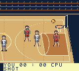

# Gameplay presentation pass 2

Implemented October 28, 2026 in response to the small players, front-facing
baskets, and disconnected scoring in the first prototype. This remains a
development prototype, not final art or finished gameplay.

## What changed

- Redrew bodies at **16×32** instead of 16×16, with the confirmed jersey numbers,
  mirrored facing, walking strides, a dribble pose, and raised-arm shooting/blocking.
- Shortened the court from 384 to **320 pixels** and reduced empty grandstand space.
  Backboards now have thin, angled profiles and rims extend inward toward play.
- Enlarged the ball. A shared rim plane aligns art and shot coordinates.
  Shots arrive above the rim, descend through an animated net, and earn points
  only after clearing it. Misses contact the rim and kick back into rebounds.
- Native object priority draws the net lip first, ball next, then depth-sorted
  players; a nearby player cannot conceal the ball at the rim.
- Added release-timing feedback, kept scoring feedback ahead of offscreen hints,
  improved camera anticipation, and spread CPU floor positions. Players continue
  moving during rim sequences. Bounded 16-bit interpolation replaces the old
  per-frame 32-bit flight divisions.

Approved portraits and supplied player ratings remain unchanged. Uniform colors
are still placeholders. The three-point distance now follows an ellipse matching
the painted arc; complete match rules and balance are later work.

## Verification

Native cartridge: `game/build/rom/nicasource-jam.gbc`, **131,072 bytes**, GBC-only,
valid header/logo/checksum. SHA-256:
`4699e47c66034e5b0ef5c84bb52cb97a29de87410830140e957750ba183378df`.
Built with the installed ModRetro plugin under Node 24.15.0, GB Studio 4.3.2,
and GBDK 4.5.0. The only compiler stderr was the upstream Node DEP0190 warning.

`sh scripts/test.sh` passes with warnings as errors, AddressSanitizer, and UBSan.
New tests check no premature points at the rim, exactly one award after net
passage, pause during a swish, and three-point boundary positions. The 30,000-update
CPU soak observed **66 shots, 61 baskets, 55 steals, and five rebounds**.

The exact native ROM was booted in PyBoy 2.7.0. Recorded checks included:

- Frames 120–180: human movement, larger full-body sprites, facing and camera.
- B held for 24 frames, then released: flight toward the right basket.
- Frames 245–270: ball above rim, at rim, through net; score still 0:0.
- Frame 274 onward: ball below the rim, score 3:0, SWISH feedback.
- Frame 476: CPU basket at the left hoop; score 3:2.
- Frames 727–757: subsequent miss, visible ricochet, and CPU rebound.
- A 90-frame paused interval changed only input-history byte 50 of `_jam`.

The crowded frame at 270 used **19 visible OAM objects**, with peak ten objects
per scanline and no over-limit scanlines. This is a sampled budget check, not
an all-overlap or physical-hardware performance certification.

## Browser handoff and limitation

The official web export compiled successfully. Web cartridge SHA-256:
`e8168da5b2cc3cfe5195217198c14d1f8630e9028caeac6bdec131b6993adb0b`.
The preview broker could not complete its old recording-close acknowledgement;
its listener was preserved. Reloading the existing URL displayed the updated
game. Ordinary onscreen Select input visibly paused it, and CPU play/scoring ran.
It is retained at the browser's **Resume game** button.

The player reported **Saved progress unavailable** and paused automatic saving
to preserve history. The message was dismissed; no history or save files were
deleted. The broker close state remains unresolved, so automatic preview inputs,
capture/annotation controls, and browser autosave are not certified. No replacement
server, forced reset, or recording replay was used.

[Build and state receipts](experience-v2-evidence.json) and the
[input journal](experience-v2-inputs.jsonl) retain evidence. Generated full recordings
remain in `game/build/experience-final/`. Cartridge records, physical hardware,
final uniforms, menu portraits, quarters, Dunk Cam, and hot hand remain later work.
