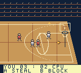

# First playable verification — October 28, 2026

Historical first-build evidence. The current build is documented in
[presentation pass 2](experience-v2.md).

The native project is `game/project.gbsproj`. MATUS and MAGIC face BAMBI and
TORRES on a 384×144 scrolling court. The prototype is continuous practice with
temporary white/red uniforms and deliberately simple 16×16 bodies. This report
does not certify the full planned game or physical Chromatic hardware.

## Build and runtime

- Installed ModRetro plugin 1.0.33, launched unchanged in a task-local MCP session
  using managed **Node 24.15.0**. CLI, GBDK, and emulator probes passed.
- GB Studio CLI **4.3.2**, GBDK **4.5.0**, PyBoy **2.7.0**.
- Native ROM: `game/build/rom/nicasource-jam.gbc`, **131,072 bytes**, GBC-only,
  valid Nintendo logo and header checksum, MBC5 cartridge.
- Native SHA-256: `ded5768eeda24d82d195c4fee19464d6ca2faeaaa7856dfec46e769e586d23a9`.
- Official browser export SHA-256:
  `3966d9c13fb54110a7949ec8e0348ef8655d39cecfa0afabb2eabf16263851c1`.
  The web export is separately compiled; its hash differs from the native build.
- Build succeeds with upstream Node `DEP0190` and SDCC optimizer warning 110
  at the height-expression line. Compiler stderr is preserved in the evidence JSON.

The inherited Codex-bound plugin session still uses Node 20. The verified managed
session and `scripts/chromatic.sh` use Node 24 without changing installed plugin
files, MCP configuration, PATH, or shell profiles. Future sessions can use that
launcher or the managed build scripts; no global repair is claimed.

## Automated rules checks

`sh scripts/test.sh` passes with C warnings treated as errors, AddressSanitizer,
and UndefinedBehaviorSanitizer. Tests cover movement/clamping, pause, pass/call
and interception, charged shots, two/three-point accounting, single-score reset,
missed/unreachable-ball recovery, CPU teammate shooting, human blocking, and a
30,000-update soak. The soak observed **64 shots, 60 baskets, 58 steals, and four
rebounds**, with valid owners and player bounds throughout. These are host rules
checks; they do not prove native banking or rendering.

## Exact-ROM input-driven checks

From a fresh recorded PyBoy boot on the native hash above:

| End frame | Held buttons / duration | Observed result |
| --- | --- | --- |
| 90 | Boot / 90 frames | Court, players, ball, HUD |
| 114 | B / 24 | Charge shot |
| 194 | None / 80 | Rightward flight and three-point basket; score 3:0 |
| 674 | None / 480 | CPU offense, two-point basket, home possession; score 3:2 |
| 675 | B / 1 | Quick shot charge |
| 755 | None / 80 | Miss and loose ball, score unchanged |
| 915 | Right + START / 160 | Human movement, camera follow, rebound recovery |
| 916 | SELECT / 1 | Pause |
| 1006 | Right + B / 90 | Simulation frozen; only input-history byte changes |
| 1007 | SELECT / 1 | Resume |
| 1031 | A / 24 | Pass flight followed by opponent interception |

Same-build symbol `_jam` locates the rules state at `0xD5FA`. Read-only snapshots
confirmed rebound count one and pause invariance; no memory writes were used.
At frame 1031, OAM inspection found ten visible objects, peak nine per scanline,
and zero scanlines over the hardware limit. This is a sampled budget check,
not a proof about every overlap or a physical performance benchmark.

The built-in browser displayed the official Binjgb player and final cartridge.
A bound Right + START input completed for 1,200 ms, advancing frames 823–895 and
releasing both buttons. The tab is retained at the browser's **Resume game**
control for the user. Browser captures/annotations and hardware installation
were not exercised.

## Evidence and remaining scope

[Build/state receipts](first-playable-evidence.json) and the
[recorded input journal](first-playable-inputs.jsonl) retain exact identities.
The [browser input receipt](browser-input-receipt.json) binds the successful hold
to the final web cartridge and player.
Generated full recordings remain under `game/build/playtest-verified/` locally.

Still planned: selectable roster/difficulties, CPU blocking, full ratings
formulas, four three-minute quarters, final uniforms and animations, portrait
menus, audio, turbo meter/dunks, Dunk Cam, hot hand, and saved records. Prototype
rules use a possession timeout, bounded loose-ball recovery, scores capped at 99,
and approximate three-point distance. These are documented first-playable limits.
