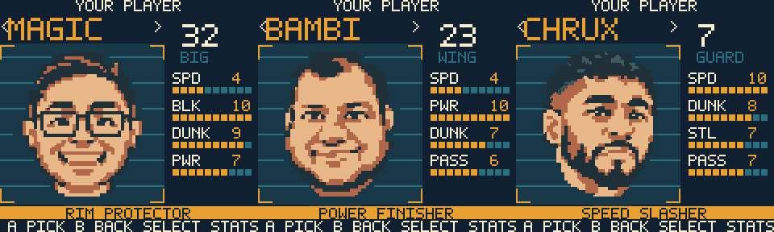
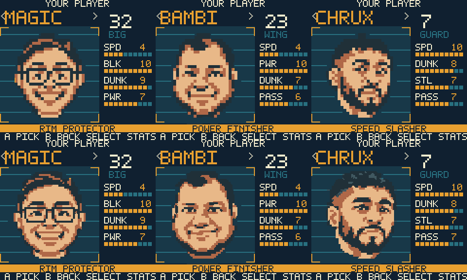

# Detailed MAGIC, BAMBI and CHRUX cards — 2026-11-03

The large cards now load new editable 96×96 portrait masters from their original
saved v1 portrait studies. These restore details lost in the compact 32×32
reconstructions: MAGIC's glasses/eyes/smile, BAMBI's facial contours and mouth,
and CHRUX's angled face, beard and slate hair highlights. Original studies and
compact source cels remain untouched; `cardSource` selects the new v2 masters.
The source photographs are not present in the repository. No new face design
or image-generation pass was substituted for the saved studies.

`scripts/reconstruct-roster-cards.py` reconstructs connected source color regions
as opaque whole cells, retaining aspect ratio and source landmark positions.
`scripts/create-front-proof.py` encodes native tiles and compatible palettes.
New likenesses are integrated for user review, not recorded as approved.

## Verification

- Official CLI cartridge build passes, GBC-only 4 MiB ROM SHA-256:
  `d6a787b670f360d0a565fd6417ce0dc4a4d3db373b6bebf18846dd2b78587579`.
- Genuine PyBoy 2.7.0 captures show all three new cards, rating-page transitions,
  CHOMPA after CHRUX's palette change, lineup selection and a fresh match.
  [Exact inputs, frames and hashes](portrait-detail/evidence.json) are retained.
  Each new card matches all 23,040 packed source pixels after RGB555 expansion.
- MATUS and CHOMPA card PNGs are byte-identical to their pre-change files.
  Original reference studies, v1 cels, jerseys, playstyles and ratings remain
  unchanged; MEAT keeps his existing compact master.
- Plugin graphics analysis passes on all three packed card PNGs with no color
  or tile violations. MAGIC/BAMBI use three palette families; CHRUX uses six.
  Actual compiled stage variants use at most 235/256 front-art pattern slots.
- Official source export and sprite-budget check pass at 190/192 tiles. This
  artwork-only change does not alter simulation code or allocate new WRAM.
- Official web export passes, ROM SHA-256:
  `4acfb11890de08c55495d9551a7335780d2b770a21cfbc1ab8266da8907d0700`.
  The separate local simulator was refreshed at player selection with this
  export. The plugin's older listener still reports unresolved recording closure
  and was left untouched. Physical hardware remains untested.

## Actual cartridge captures

Before (top, previous packed source) and after (bottom, actual cartridge frames):

[MAGIC ratings](portrait-detail/magic-ratings.png),
[BAMBI ratings](portrait-detail/bambi-ratings.png),
[CHRUX ratings](portrait-detail/chrux-ratings.png), and
[match entry](portrait-detail/lineup-6.png).
