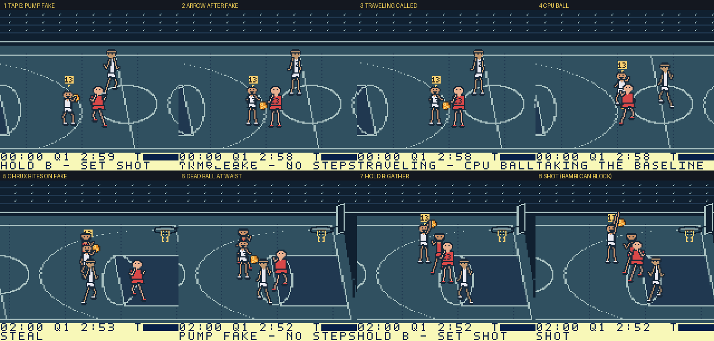

# Pump fake and traveling — 2026-11-03

## Rule

- **Tap B** (released before `JAM_FAKE_FRAMES` = 8 simulation ticks) while
  holding the ball is a **pump fake**: no shot, no jump, the ball lifts for
  `JAM_FAKE_SHOW` ticks in the gather pose, and the HUD shows
  `PUMP FAKE - NO STEPS`.
- The fake **ends the dribble**. The ball is held at the waist (half the
  player's height, so a reach no longer gets the low-dribble steal bonus) and
  the HUD shows `PICKED UP - NO STEPS`. From there the player may shoot
  (hold B), pass (A), fake again, or dunk with turbo + B.
- **Traveling:** with a dead ball, any new arrow press, or arrows still held
  more than `JAM_GATHER_STEP` = 10 ticks after the fake, whistles the play
  dead (`TRAVELING - CPU BALL`) and gives the other team a baseline inbound,
  the same path as an out-of-bounds call. The short gather step lets a player
  who faked while running come to a stop.
- **Hold B** is unchanged as a real shot: the timing window (18–36) and its
  bonus are the same. The only lost input is the old instant flick shot,
  which is now the fake. Feet are set while gathering (previously the
  shooter drifted at speed 2), so gathering is never traveling.
- **Defenders bite.** When the fake is released, each opposing CPU defender
  within block reach rolls `35 + block×3 − level×10` percent (MAGIC: 65/55/45
  for Warm-up/Pickup/Winners Stay). A defender who bites jumps
  (`block_time`), cannot move or reach while in the air, and for
  `JAM_BITE_FRAMES` = 45 ticks neither contests the next shot's percentage
  nor gets a block attempt. Real gathers are never rolled, so ordinary
  shot-blocking is unchanged. CPU ball carriers do not fake yet.

Code: `jam_fake.c` owns the fake, dead-ball and travel logic. It lives in its
own bank because `jam_sim.c` would have exceeded 16 KB (16,747 bytes);
`jam_sim.c` is now 16,096 bytes.

## Validation

- Rules tests (`pump_fake_and_travel` in `tests/jam_sim_test.c`) cover tap =
  fake with no shot or jump, the waist hold, repeated fakes, travel on a new
  press and after the gather step, stopping inside the step, a real shot
  with set feet, passing out of a dead ball, bite rates over 400 seeded fakes
  per level (262/222/188, expected 260/220/180), a bitten defender frozen in
  the air, no contest and no block attempt, and the bite expiring. The
  boundary and control-handoff tests were updated: a gathering shooter can no
  longer drift out of bounds, and a one-tick B tap is now a fake. All
  sanitizer tests pass.
- Official CLI ROM build passes, SHA-256
  `c5db430fc901bd0351bf21748bebe571d08b8bdcd852ae18a2353cce111045b5`.
  Stack headroom is 528 bytes (minimum 512; four new bytes of state).
  No sprite art changed.
- Emulator play of that ROM with `pump-fake/fake.py` (PyBoy, MATUS + MAGIC
  vs BAMBI + CHRUX, the lineup inputs from `sprite-likeness/`): the driver
  reads `jam` live, dribbles at the defense, and alternates "fake then step"
  with "fake then shoot". Every step after a fake was called traveling and
  led to a CPU inbound; every shot out of a fake launched. CHRUX bit on one
  fake and made no block attempt on the following shot; BAMBI, who did not
  bite, still blocked it, as intended.
  [Captures](pump-fake/pump-fake.png). Frame 2 catches the HUD mid-redraw
  (the existing row-streamed HUD), frame 3 shows it settled.
- Simulation ticks run slower than VBlank on hardware timing, so the 8-tick
  fake threshold is roughly a quarter second of real time.
- Browser preview and physical hardware are unverified for this change.

