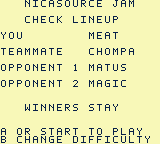
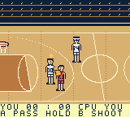

# Player Selection and Ratings Verification

Implemented and verified October 28, 2026. This milestone adds configurable
practice lineups; full four-quarter matches remain the next milestone.

## Delivered behavior

- Native six-player picker with approved 32×32 portraits, position, signature,
  jersey, and all eight supplied ratings.
- Choose the controlled player, CPU teammate, two different opponents, and
  Warm-up/Pickup/Winners Stay; used players are skipped.
- Review before starting; B backtracks without launching. Held A cannot select
  twice. SELECT pauses practice; B while paused returns to selection.
- All selected identities render with their jersey and team color, including
  CHOMPA 74 and MEAT 00. Controls remain on the selected human throughout.
- Every rating has an implemented gameplay effect; opponent difficulty changes
  movement, probabilities, defensive reaction, range, and steal cooldown.
  See [formulas and controls](../design/ratings.md). Signature labels remain flavor.

## Host checks

`sh scripts/test.sh` passes C99 with warnings as errors, AddressSanitizer, and
UBSan. It verifies all **1,080** distinct ordered lineups/difficulty combinations,
movement of the chosen player, duplicate rejection, backtracking, held-key
handling, invalid setup preservation, exact roster values, and jersey strings.

Behavior comparisons cover speed, shooting, pass timing/accuracy, contact power,
clutch conditions, and difficulty. Across 256 seeded attempts, MAGIC blocked
215 shots versus MATUS's 71; MATUS stole 105 times versus MAGIC's 29 against
the same carrier. CPU shot blocking is also exercised. All three levels pass
12,000-update soaks; the separate 30,000-update soak produced 133 shots,
51 baskets, 70 steals, and 82 rebounds. Existing scoring, passing, rebounds,
boundaries, pause, and rim/three-point checks also pass.

## Exact native ROM

- GBC-only, 131,072 bytes; valid Nintendo logo and header checksum.
- SHA-256: `d40b377142f3b6688709f3c74975a07ad9d5c9a0fdeeaa823d21acf4332bb017`.
- Official plugin build under managed Node 24, GB Studio 4.3.2, GBDK 4.5.0.
- Stderr: upstream Node DEP0190 and three SDCC optimizer-flow warning 110 messages;
  compilation and linking succeeded. These warnings were followed by actual ROM tests.

PyBoy 2.7.0 recorded a clean boot at frame 120 and 67 bounded input calls through
frame 2308. Retained input intervals are contiguous. Actual frames verified:

- 120/132/144/156/168/180: all six portrait/rating pages.
- 504: reviewed MEAT + CHOMPA versus MATUS + MAGIC, Winners Stay.
- 510–590: selected identities and gameplay after more than 256 frames in menus.
- 625–713: movement, passing, and pause; 725: return to the picker.
- 833: reviewed CHOMPA + MATUS versus MAGIC + BAMBI, Warm-up.
- 924–1108: CHOMPA movement, charged shot, rim sequence, and a made three-pointer.
- 2308: CPU reply, score 3:2, with players and ball still rendering correctly.

Sampled OAM at 590 and 2308 used 15 visible objects, peak five per scanline,
with zero over-limit scanlines. This does not certify all overlaps or hardware.

An earlier retained attempt exposed a static ball animation frame advancing
beyond its single-frame sprite while hidden in menus, exhausting OAM on launch.
Explicit static frame bounds fixed it. The final ROM passed the prolonged-menu
regression and subsequent play. The failed recording remains in ignored local
build evidence; it was not relabeled as a successful run.

See [machine-readable evidence](selection-ratings-evidence.json) for exact ROM,
runtime, input intervals, sampled OAM, frame hashes, and retained screenshot paths.
The original recording export had 347 normalized actions; the evidence file
retains all 67 higher-level input calls, not only the export's first page.

## Official browser player

The official web export built successfully. Its separately compiled ROM SHA-256 is
`17382545479d07bec6fe24070ac33cfe0c7326014da163fa76c80b02bc73714b`.

The built-in browser verified keyboard arrows and Z through player, teammate,
opponent, difficulty, and review screens. MAGIC + BAMBI versus TORRES + CHOMPA
at Pickup launched with Enter. Movement, P pause, and X return-to-selection were
visibly verified. A current-build autosave was verified on disk. The preview is
left on the first player picker, with input ready and no active recording.

The previous presentation build was saved at frame 51236 (state
`18137dd84f7cf11547bda083df36cbf100e6436f6936b640022a90283526c371`).
Its plugin close acknowledgement returned UNKNOWN despite an idle recorder.
Only the task-owned service was restarted; the old save/history was preserved.
This is a preview-service limitation, not a claimed completed recording save.
The replacement service serves the verified current export with closure state open.

## Remaining scope

Selection UI/body art are prototype presentation; the longest difficulty helper
line currently wraps. Balance tuning, four-quarter flow, final uniforms, sound,
actual dunk animations/Dunk Cam, fire streaks, cartridge records, and physical
Chromatic testing remain later work. Dunk rating currently affects close finishing;
clutch uses late possession in a close practice game until quarter clocks exist.
