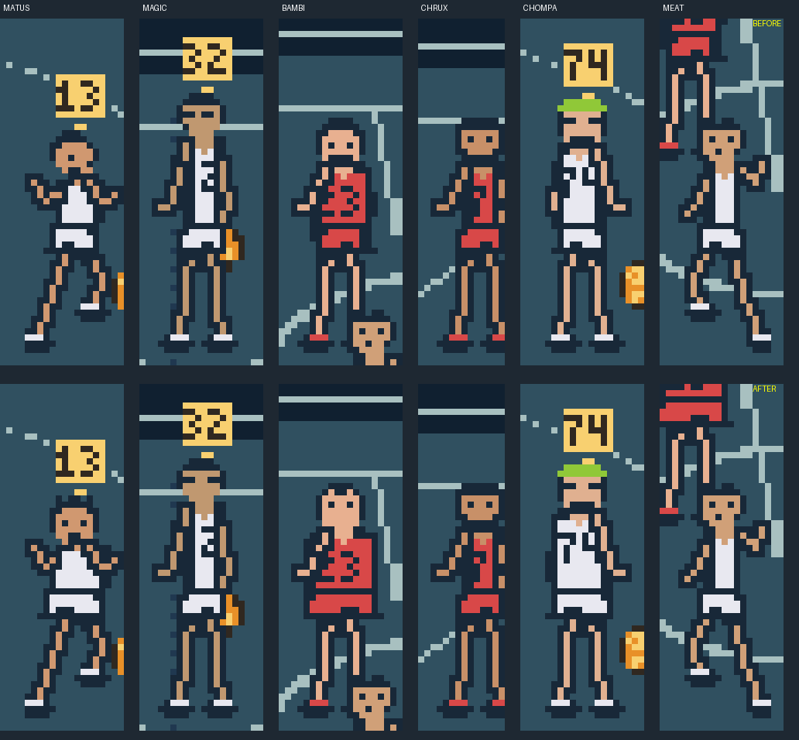

# On-court sprite likeness — 2026-11-03

The exact cartridge was played in PyBoy (ModRetro toolchain venv) across four
matches so that all six players appeared on cards, on court and in Dunk Cam.
Court sprites were isolated by their CGB OBJ palette (palette = roster ID;
CHOMPA's beanie palette 7 merged into his crop).

## Assessment before this change

- Cards closely follow the approved studies ([comparison](sprite-likeness/ref-vs-card.png)).
  MEAT remains the 32×32 card enlargement and is visibly blockier than the
  five 96×96 cards.
- On court, height ordering (36–42 px) read correctly, but build did not:
  BAMBI (heavy) gained only one pixel per side, MATUS/CHOMPA (stocky/broad)
  none. BAMBI's face had a dark jaw ring that read as a beard, unlike his
  clean-shaven card; MATUS's goatee read as a full beard; MAGIC's glasses row
  was asymmetric.

## Changes (`scripts/player-poses.mjs`)

- Ready/run/turn poses widen the trunk and shorts by build: heavy +2, broad or
  stocky +1, lean −1 per side. Extra width stops above row 32 so the shared
  leg tiles still deduplicate; shot/contact poses remain shared, as before.
- Faces: MATUS spiked hair and a centered goatee; MAGIC symmetric glasses;
  BAMBI a receding hairline and clean round jaw. CHRUX, CHOMPA and MEAT
  are unchanged.
- Dunk Cam frames were regenerated because they reuse the court head cells
  ([comparison](sprite-likeness/dunk-before-after.png)).

Skin tones were deliberately left alone: every card shares one skin palette and
no photographs exist in the repository, so per-player complexions would be
invented likeness data rather than evidence.

## Merge with main (`e5d6e2e`)

Main replaced the eight-pixel faces with ten-pixel heads. The merge keeps
those heads and the build widths, and reapplies the BAMBI cue (receding
hairline, clean round jaw) on the ten-pixel grid. MATUS and MAGIC use main's
redrawn faces. Crew sprites now allocate 192/192 tiles (main alone uses 190),
which passes the loader check but leaves no spare tiles.
[Merged on-court sprites](sprite-likeness/merged-sprites.png).

## Tile budget recovery

The merge left the crew at 192/192 tiles. Measured on the sheet with
`sprite-likeness/tilecount.py` (unique 8×16 tiles, x-flip merged, which
matches the loader to within one tile) and confirmed with the real check:

- MATUS and CHOMPA (stocky/broad) no longer widen; only BAMBI (+2) and the
  lean players (−1) change width. This saves one tile.
- Removing width from the turning poses saved nothing: their arms and heads
  already make those tiles unique.
- BAMBI's clean chin now tapers like MAGIC and MEAT (`..oooooo..`,
  `...oooo...`), so his chin and neck pieces are shared. A dark-jaw variant
  also shared tiles, but it read as a beard again and was rejected.

Result: crew 172 tiles, loader **186/192** (main alone used 190). Stack
headroom remains 532 bytes, Dunk Cam peaks at 124/128 tiles, and the rules
tests pass. Emulator replays show the same lineups
([before/after](sprite-likeness/tile-budget-sprites.png)) and clean Dunk Cam
events ([captures](sprite-likeness/tile-budget-dunks.png)). ROM SHA-256
`cc2cab60a48fa0e8c7cf54ef759c891830475c8f0bbbe4b69cc256345fb93bc0`.

## Validation (branch, before merge)

- Official CLI ROM build passes, SHA-256
  `6f9f99be737632c36b64a1fed6af230d3dd5e6acd675834cadfa8d9aedfeba79`.
- Source export and sprite budget pass at 190/192 tiles (unchanged). A first
  attempt that widened every pose reached 200/192 and was rejected.
- Dunk Cam generation stays at 123/128 tiles maximum.
- All sanitizer rules tests pass.
- Same deterministic inputs replayed on the old and new ROMs; players stand in
  identical positions, giving a direct [before/after](sprite-likeness/sprites-before-after.png).
  Inputs and the driver are in `sprite-likeness/`.
- Browser preview and physical hardware are unverified.

